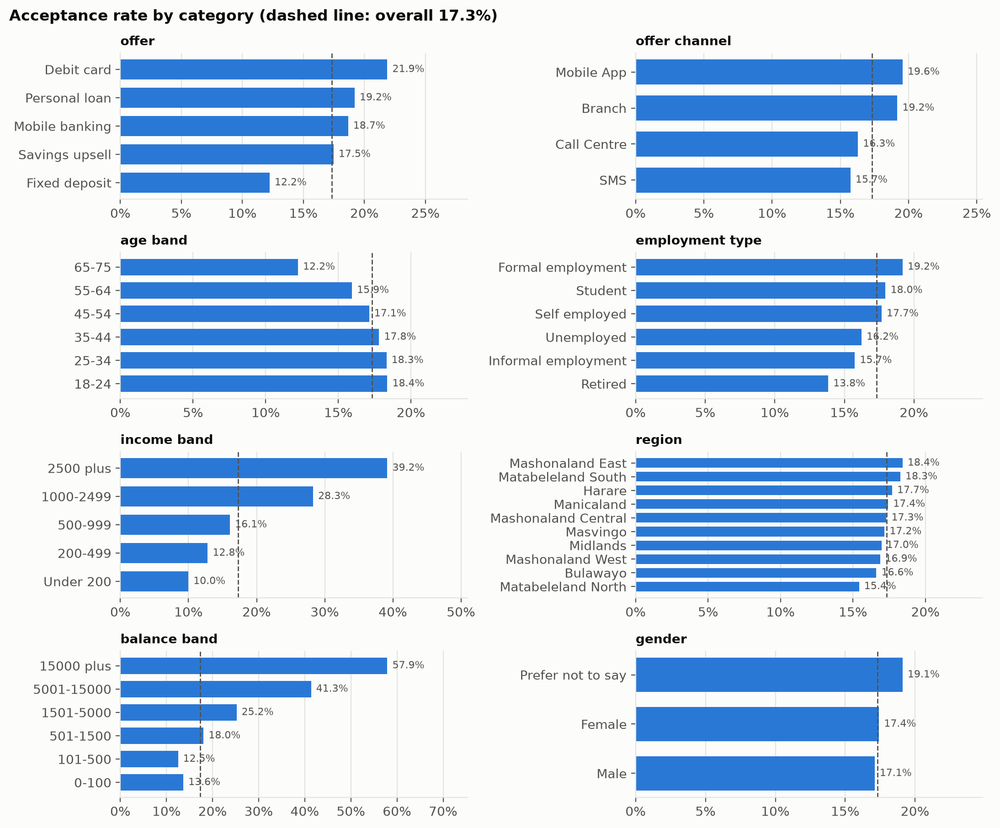
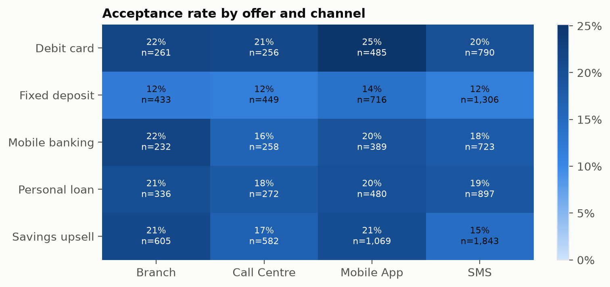
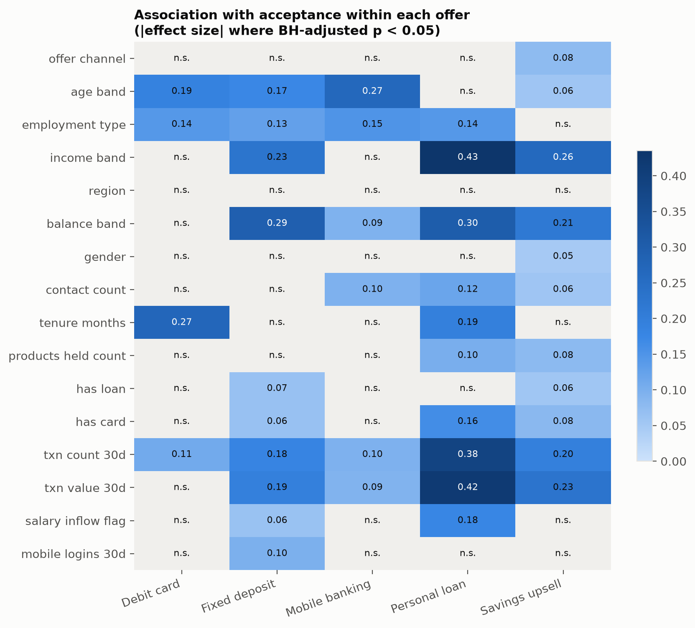
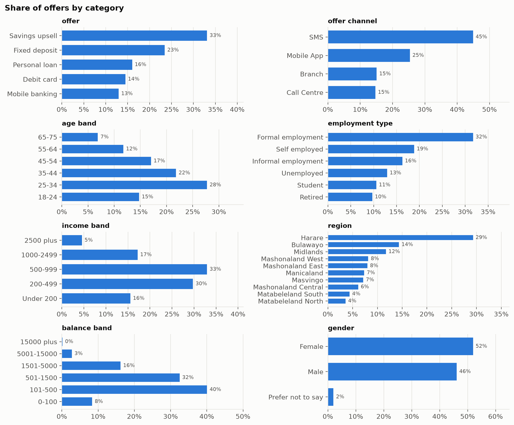
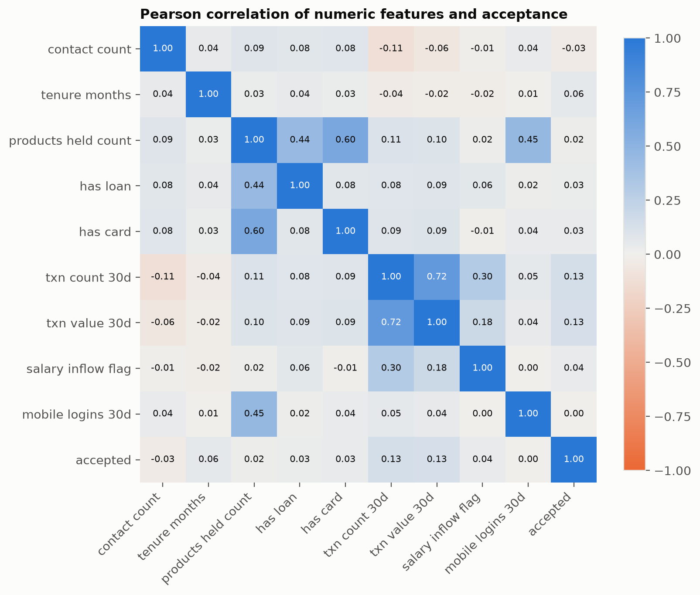
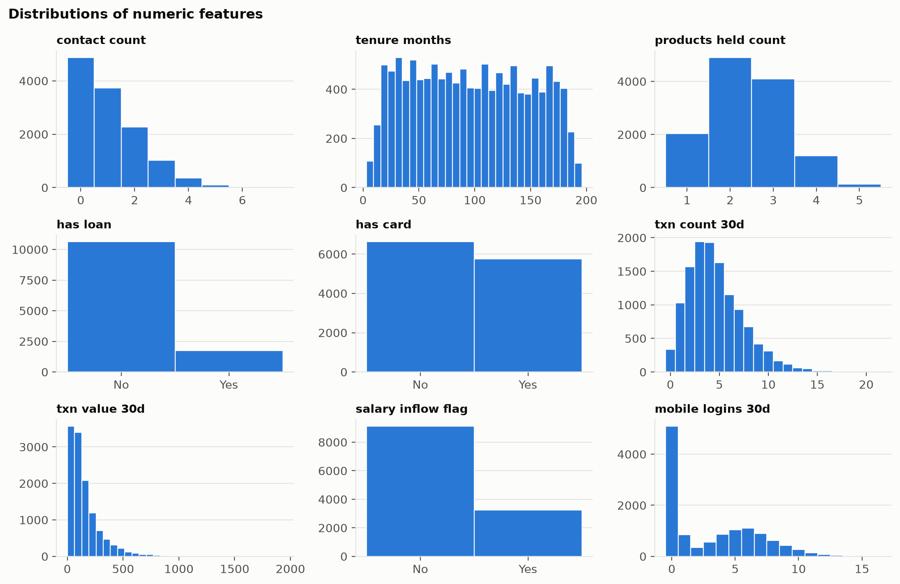
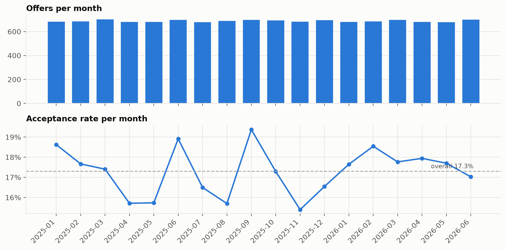

# Data understanding (Chapter 3)

Dataset `data/raw/mydata.csv`: 12,382 offers, 23 columns, 4,882 customers, 5 offers, 2025-01-01 to 2026-06-28. Overall acceptance rate 17.3%. Generated by `make eda`.

## Data quality

| Check | Result |
|---|---|
| Missing values | 0 in total |
| Duplicate rows | 0 |
| Duplicate customer + date + offer | 0 |
| Pseudonymous customer ids (SYN...) | yes, all |
| PII pattern matches (e-mail, phone, national id, 10+ digit runs) | email 0, phone 0, national_id 0, long_digit_run 0 |

IQR outliers (values beyond 1.5 x IQR; reported, not removed):

| Feature | Outliers |
|---|---|
| contact count | 26 |
| tenure months | 0 |
| products held count | 136 |
| has loan | 1,750 |
| has card | 0 |
| txn count 30d | 455 |
| txn value 30d | 787 |
| salary inflow flag | 0 |
| mobile logins 30d | 2 |

## Association with acceptance, all offers pooled

| Variable | Test | Statistic | df | p-value | Effect size |
|---|---|---|---|---|---|
| income band | chi-square | 496.7 | 4 | 3.5e-106 | Cramer's V 0.200 |
| balance band | chi-square | 337.8 | 5 | 7.29e-71 | Cramer's V 0.165 |
| txn value 30d | Mann-Whitney U | 13136791.5 |  | 5.75e-47 | rank-biserial r 0.197 |
| txn count 30d | Mann-Whitney U | 13053751.5 |  | 3.69e-44 | rank-biserial r 0.190 |
| action | chi-square | 85.6 | 4 | 1.12e-17 | Cramer's V 0.083 |
| tenure months | Mann-Whitney U | 11917444.5 |  | 3.19e-10 | rank-biserial r 0.086 |
| offer channel | chi-square | 26.5 | 3 | 7.37e-06 | Cramer's V 0.046 |
| salary inflow flag | Mann-Whitney U | 11419760.5 |  | 9.22e-05 | rank-biserial r 0.041 |
| has card | Mann-Whitney U | 11470408.0 |  | 0.000122 | rank-biserial r 0.046 |
| employment type | chi-square | 25.1 | 5 | 0.000136 | Cramer's V 0.045 |
| age band | chi-square | 21.7 | 5 | 0.000602 | Cramer's V 0.042 |
| has loan | Mann-Whitney U | 11250431.5 |  | 0.00209 | rank-biserial r 0.025 |
| contact count | Mann-Whitney U | 10545438.5 |  | 0.00294 | rank-biserial r -0.039 |
| products held count | Mann-Whitney U | 11244182.0 |  | 0.0552 | rank-biserial r 0.025 |
| gender | chi-square | 0.8 | 2 | 0.679 | Cramer's V 0.008 |
| mobile logins 30d | Mann-Whitney U | 10943933.0 |  | 0.851 | rank-biserial r -0.002 |
| region | chi-square | 3.6 | 9 | 0.938 | Cramer's V 0.017 |

Pooling mixes offers with different acceptance rates, so the within-offer results below are the better guide to which factors matter.

## Association with acceptance within each offer (Benjamini-Hochberg adjusted p)

| Variable | Debit card | Fixed deposit | Mobile banking | Personal loan | Savings upsell |
|---|---|---|---|---|---|
| offer channel | 0.294 | 0.585 | 0.545 | 0.938 | 5.24e-05 * |
| age band | 1.26e-11 * | 3.94e-16 * | 6.87e-22 * | 0.626 | 0.038 * |
| employment type | 3.4e-06 * | 2.84e-08 * | 4.97e-06 * | 3.79e-08 * | 0.742 |
| income band | 0.635 | 2.11e-30 * | 0.916 | 4.15e-78 * | 2.56e-58 * |
| region | 1 | 0.491 | 0.553 | 0.635 | 0.971 |
| balance band | 0.235 | 2.57e-51 * | 0.0315 * | 6.93e-36 * | 3.17e-37 * |
| gender | 0.285 | 0.553 | 1 | 0.148 | 0.018 * |
| contact count | 0.194 | 0.0934 | 0.0152 * | 0.00046 * | 0.0245 * |
| tenure months | 1.32e-15 * | 0.808 | 0.433 | 1.59e-08 * | 0.75 |
| products held count | 1 | 0.271 | 0.189 | 0.00268 * | 0.00115 * |
| has loan | 0.75 | 0.0078 * | 0.891 | 1 | 0.00115 * |
| has card | 1 | 0.0401 * | 0.148 | 4.21e-08 * | 0.000202 * |
| txn count 30d | 0.00242 * | 8.53e-08 * | 0.0219 * | 6.37e-31 * | 8.83e-16 * |
| txn value 30d | 0.119 | 1.43e-08 * | 0.0248 * | 8.91e-36 * | 5.17e-21 * |
| salary inflow flag | 1 | 0.022 * | 0.962 | 1.04e-09 * | 0.888 |
| mobile logins 30d | 0.798 | 0.00594 * | 1 | 0.125 | 0.17 |

\* significant at 5% after adjustment across all within-offer tests.

## Strongest correlations between numeric features

| Pair | Pearson r |
|---|---|
| txn count 30d – txn value 30d | 0.715 |
| products held count – has card | 0.597 |
| products held count – mobile logins 30d | 0.454 |
| products held count – has loan | 0.445 |
| txn count 30d – salary inflow flag | 0.298 |
| txn value 30d – salary inflow flag | 0.182 |
| txn count 30d – accepted | 0.133 |
| txn value 30d – accepted | 0.126 |

## Figures

