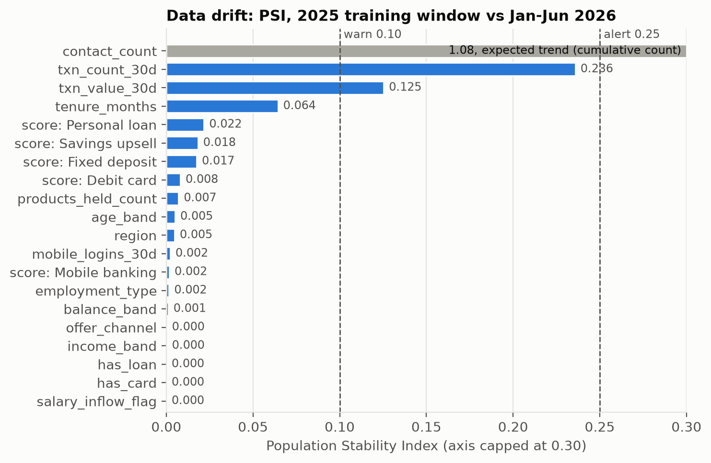
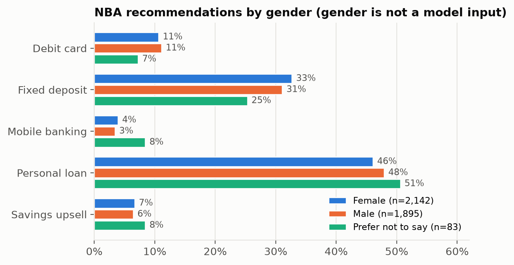
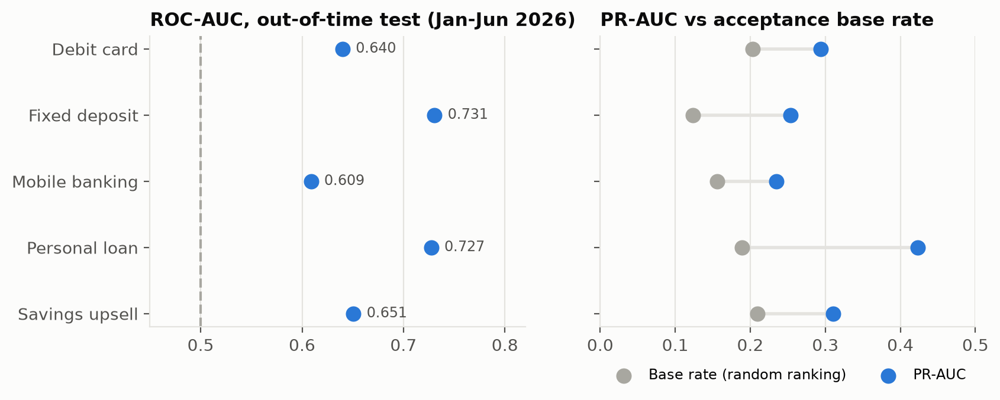
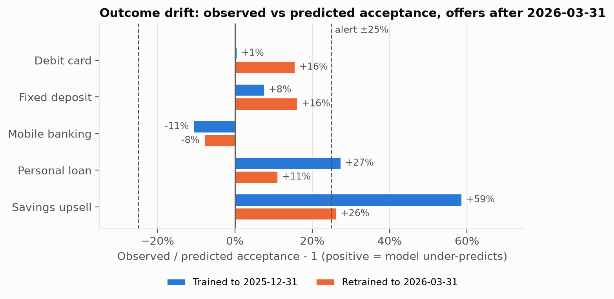
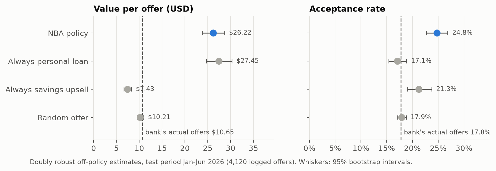
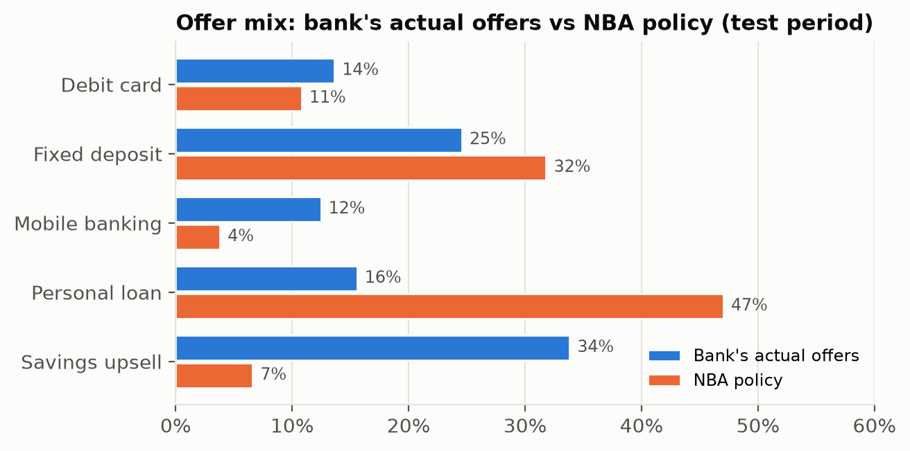
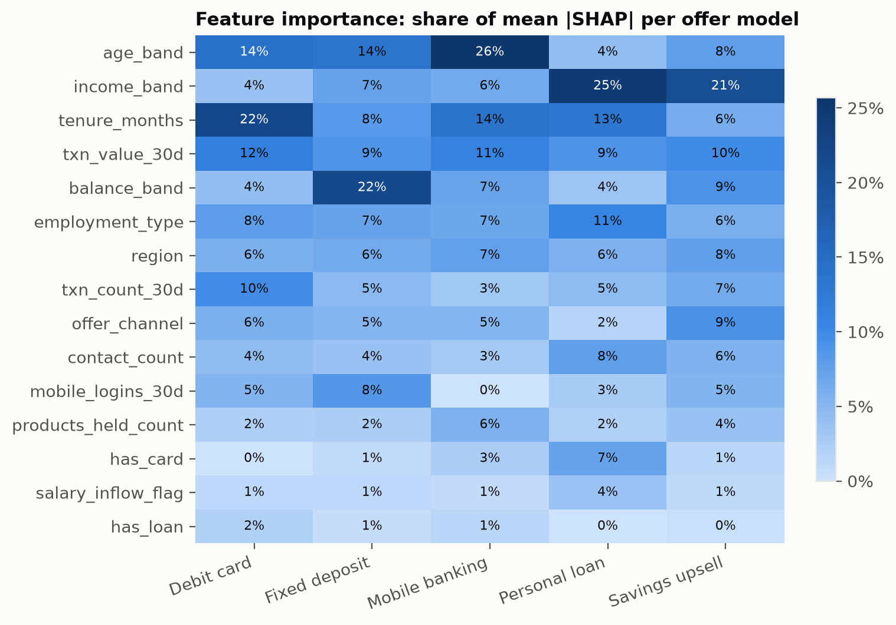

# Chapter 4 results

Training run `f0e62fe514ab4f4ca7287a1e30b5188c`, git commit `313d078`, data sha256 `7ade696aec79`, image `6299cc5f51a1`.
Out-of-time test period 2026-01-01 to 2026-06-28, 4,120 logged offers. Generated by `make report`.

## Acceptance models

| Offer | Train n | Test n | Test acceptance | ROC-AUC | PR-AUC | Brier |
|---|---|---|---|---|---|---|
| Debit card | 1231 | 561 | 20.3% | 0.640 | 0.294 | 0.1673 |
| Fixed deposit | 1892 | 1012 | 12.4% | 0.731 | 0.254 | 0.1041 |
| Mobile banking | 1089 | 513 | 15.6% | 0.609 | 0.235 | 0.1417 |
| Personal loan | 1344 | 641 | 18.9% | 0.727 | 0.423 | 0.1410 |
| Savings upsell | 2706 | 1393 | 21.0% | 0.651 | 0.311 | 0.1665 |

## Policy evaluation (off-policy, test period)

| Policy | Value per offer, USD, DR [95% CI] | SNIPS | IPS | Acceptance rate, DR [95% CI] | Matched offers |
|---|---|---|---|---|---|
| NBA (expected value) | 26.22 [23.87, 28.69] | 21.57 | 14.99 | 0.248 [0.227, 0.269] | 777 |
| Best single offer | 27.45 [24.69, 30.31] | 26.77 | 16.41 | 0.171 [0.154, 0.189] | 641 |
| Most offered | 7.43 [6.65, 8.29] | 7.38 | 7.47 | 0.213 [0.190, 0.237] | 1,393 |
| Random | 10.21 [9.55, 10.93] | 10.43 | 7.11 | 0.179 [0.171, 0.188] | 4,120 |
| Bank's actual offers (observed) | 10.65 [9.73, 11.63] | | | 0.178 | 4,120 |

Propensity check: mean importance weight under a uniform policy = 0.682 (1.0 if the logged propensities are proper probabilities over the five offers), so SNIPS and DR are preferred over IPS.

## Calibration (test period, offers actually made)

| Offer | Observed acceptance | Mean predicted | Brier |
|---|---|---|---|
| Debit card | 0.203 | 0.215 | 0.1673 |
| Fixed deposit | 0.124 | 0.116 | 0.1041 |
| Mobile banking | 0.156 | 0.173 | 0.1417 |
| Personal loan | 0.189 | 0.151 | 0.1410 |
| Savings upsell | 0.210 | 0.137 | 0.1665 |

## Fairness by gender (gender is not a model feature)

| Group | n | Acceptance | AUC | Share recommended personal loan |
|---|---|---|---|---|
| Female | 2,142 | 0.171 | 0.686 | 46.1% |
| Male | 1,895 | 0.186 | 0.670 | 47.9% |
| Prefer not to say | 83 | 0.169 | 0.565 | 50.6% |

## Drift (2025 training window vs Jan-Jun 2026)

| Signal | Value | Status |
|---|---|---|
| PSI contact_count | 1.076 | alert (expected trend, not used for retrain) |
| PSI txn_count_30d | 0.236 | warn |
| PSI txn_value_30d | 0.125 | warn |
| All other features and model scores | PSI < 0.064 | ok |
| Calibration gap Debit card | -5% | ok |
| Calibration gap Fixed deposit | +7% | ok |
| Calibration gap Mobile banking | -10% | ok |
| Calibration gap Personal loan | +25% | warn |
| Calibration gap Savings upsell | +54% | alert |

Retrain recommended: **True** (calibration gap Savings_Account_Upsell).

## Retraining (scored on offers after 2026-03-31)

| Offer | AUC trained to 2025-12-31 | AUC retrained | Gap before | Gap after |
|---|---|---|---|---|
| Debit card | 0.616 | 0.608 | +1% | +16% |
| Fixed deposit | 0.751 | 0.780 | +8% | +16% |
| Mobile banking | 0.600 | 0.622 | -11% | -8% |
| Personal loan | 0.737 | 0.745 | +27% | +11% |
| Savings upsell | 0.630 | 0.646 | +59% | +26% |

## Figures

